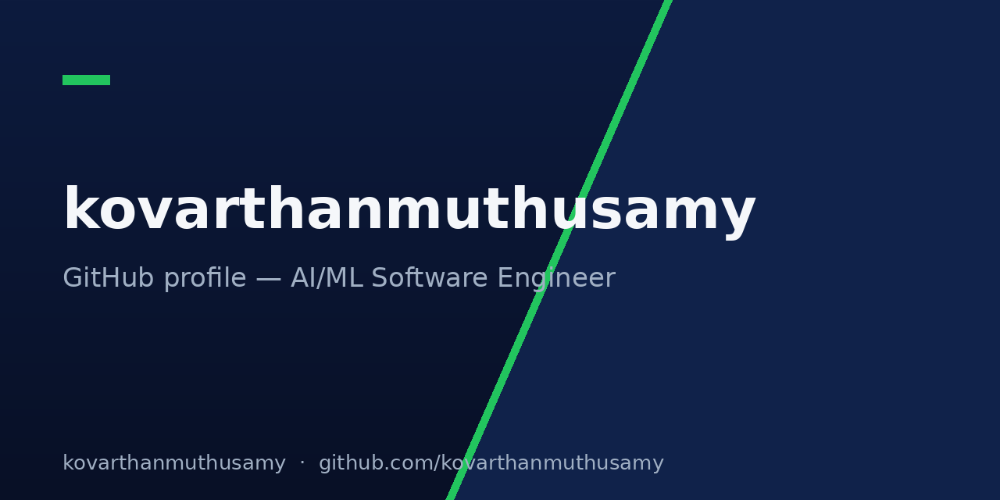

<h1 align="center">Kovarthanam Muthusamy</h1>
<h3 align="center">AI/ML Software Engineer — I solve companies' AI problems</h3>

I help companies put AI to work — not as demos, but as software that runs in production. Most teams I work
with have the same problem: data and ideas for AI, but no reliable way to turn them into a system customers
can use. I build that bridge — from first prototype to a product running in production.

📍 Dortmund, Germany · 🎓 M.Sc. Automation and Robotics, TU Dortmund (2027) · ✉️ kovarthanmuthusamy@gmail.com

  
  
  

---

## What I solve for companies

- **LLM applications and agents that handle real tasks end to end.** Multi-agent assistants with an
  orchestrator, RAG, LoRA fine-tuning and typed, validated tool calling — built to work in the real world,
  not just in a notebook.
- **RAG systems — retrieval, grounding and evaluation, not just a chatbot.** Document search and domain
  knowledge your team can trust, with evaluation so you know what it gets right and what it doesn't.
- **Model inference and deployment.** APIs, Docker, CI/CD and cloud infrastructure, so a model becomes a
  tested, reproducible service instead of a script on someone's laptop.
- **MLOps that keeps systems reliable.** Pipelines, monitoring and retraining, so the system you ship keeps
  working after it ships.
- **Engineering domains.** Simulation-driven learning for electronics (PCB power and signal integrity), on
  top of a background in robotics and mechanical design.

## Proof, not promises

- **IEEE paper** on generative AI for engineering design (2026 Kleinheubach Conference).
- **End-to-end generative AI platform** shipped as production software — predicts a board's power behaviour
  in milliseconds instead of a 12-second simulation.
- **Self-healing Kubernetes agent** that diagnosed a live failure and proposed the fix in **37 s for $0.04**.

If your team has an AI problem worth solving, let's talk.

## Featured projects

### 🔌 [Generative AI System for Engineering Analysis](https://github.com/kovarthanmuthusamy/Generative-AI-System-Engineering-Analysis) — AI for circuit-board power design

An AI model that predicts how a board's power supply behaves in milliseconds instead of a
12-second simulation, plus a web app that suggests better designs. Published at the [2026 Kleinheubach Conference (IEEE)](https://doi.org/10.23919/IEEECONF72572.2026.11743273).

- Trained on **30,000 simulated layouts**; typical error **2.9 %**
- Checks **≈ 25,000 layouts per second** vs ≈ 12 s per layout in the simulator
- Finds designs with the fewest components; **87–98 %** of proposals pass a real simulation
- Web app + API, Docker, CI, MLflow, 116 automated tests
- Model inference built for Azure ML (managed online endpoint, CPU)

`PyTorch` `DDP` `VAE` `FastAPI` `Docker` `GitHub Actions` `MLflow` `Azure ML`

### 🤖 [AI Assistant System for ECAD Software](https://github.com/kovarthanmuthusamy/AI-assistant-system-for-ECAD-software)

Team project (8 people). Answers circuit-design questions, runs simulations from plain English and explains
the results. I built the agent logic and most of the backend.

- A coordinating agent routes each request to the right specialist: expert model, document search or simulation
- Runs on local or cloud models (DeepSeek-R1, GPT-4o, Gemini) without code changes
- Fine-tuned an 8B open-source model (LoRA) as the domain expert
- Plain English → checked simulation settings; 130 automated tests

`LangChain` `RAG` `ChromaDB` `LoRA` `Ollama` `Pydantic`

### 🚗 [Camera + LiDAR Perception Service](https://github.com/kovarthanmuthusamy/sensor-fusion)

Spots cars and people and tells how far away they are, from a camera and LiDAR.

- LiDAR cuts the distance error **8.1 % → 4.3 %**, at night **10.9 % → 3.6 %**
- Answers in **≈ 0.1 s on a CPU**, about 10 requests per second
- Production-ready API: health checks, monitoring, logging, overload protection, secure container
- 372 tests (95 % coverage); built with Claude Code, every change reviewed

`PyTorch` `ONNX Runtime` `FastAPI` `Docker` `Prometheus` `Claude Code`

### 🗺️ SLAM and Localization using TurtleBot — coursework lab, TU Dortmund

Coursework lab at TU Dortmund. Built SLAM and localization for a TurtleBot — the robot maps its environment and localizes itself within it, so it can navigate autonomously.

- SLAM: the TurtleBot builds a map of its environment while tracking its own position in it
- Developed and tested in Gazebo, visualized in RViz; motion planning with MoveIt

`ROS 2` `Python` `MoveIt` `Gazebo` `RViz`

### 💶 [Finance Agent](https://github.com/kovarthanmuthusamy/finance-agent) — private budgeting and forecasts

Turns bank statements into budgets and cash-flow forecasts. All data stays on the user's computer.

- Imports Sparkasse exports and skips duplicates automatically
- Forecasts 14–90 days ahead and shows the risk of running low on money
- SQLite with versioned schema changes and exact cent amounts; 31 tests in CI

`Python` `Streamlit` `SQLAlchemy` `Alembic` `pytest`

### 🩺 [KubeMedic](https://github.com/kovarthanmuthusamy/kubmedic) — AI agent that fixes broken cloud apps

Finds why a Kubernetes app broke and proposes the fix as a pull request for a human to approve.

- **Live demo (Nov 2026):** diagnosed a bad image tag (ImagePullBackOff) in a live cluster and proposed
  the fix in **37 s for $0.04** — [demo report](https://github.com/kovarthanmuthusamy/kubmedic/blob/main/evals/results/2026-11-21-frontend-bad-image-tag/KubMedic-Demo-Report.pdf)
- Built with LangGraph (triage → investigate → plan), MCP tools and Langfuse traces
- Safe by design: the agent can only read; every fix needs human approval
- Platform: local Kubernetes cluster and local AI models on two GPUs, set up reproducibly

`Kubernetes` `Ollama` `LangGraph` `MCP` `ArgoCD`

## Publications

- N. G. Shoaee, **K. Muthusamy**, W. John, R. Brüning and J. Götze, "[A Variational Autoencoder Framework for PCB Power Delivery Network Design](https://doi.org/10.23919/IEEECONF72572.2026.11743273)," *2026 Kleinheubach Conference*, Miltenberg, Germany, 2026, pp. 1–4. IEEE.
  A generative AI model that designs PCB power networks meeting a target impedance with as few capacitors as possible, without slow EM simulations.

## How I build with agents

- **I use coding agents (Claude Code, Cursor) like a team I direct:** they write code, I make the design decisions and review every change.
- **Guard rails:** every number cites a result file, CI runs on every push, and pull requests stay small.

## Tech stack

| | |
|---|---|
| **ML & data** |         |
| **LLMs & agents** |         |
| **MLOps & serving** |        |
| **Data & apps** |     |
| **Engineering & tools** |         |

## Background

Before machine learning I worked on robotic welding, mechanical design, industrial automation and CAD-based
engineering workflows.

**Interests:** simulation-driven ML · generative models for engineering design · agentic AI for engineering
tools · MLOps for research code

---

AI/ML systems · Agentic AI · MLOps — built to solve your problem, not to sit in a notebook

